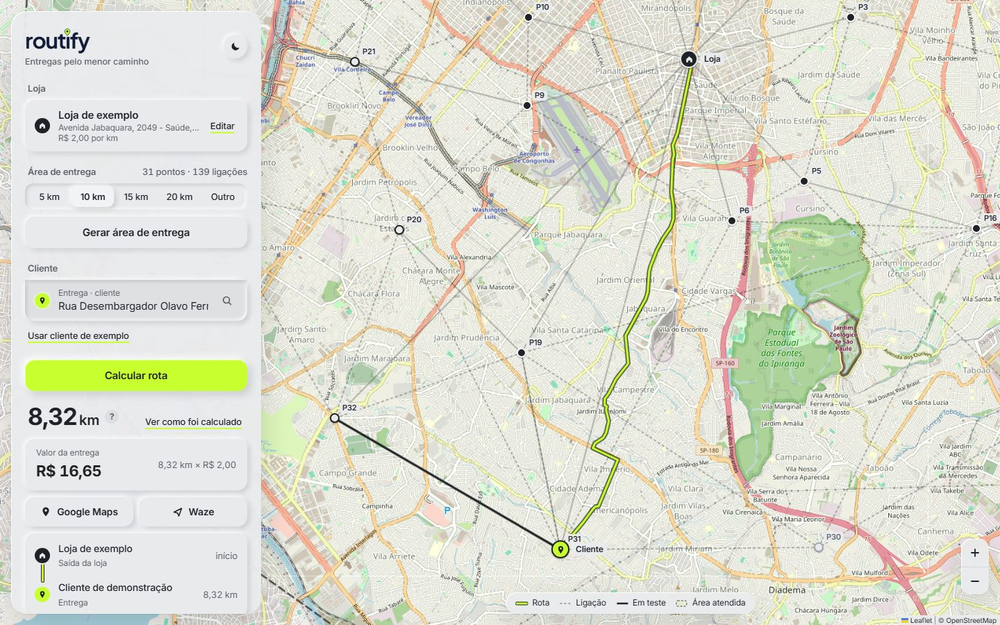
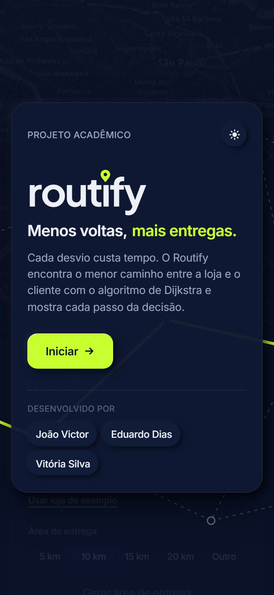
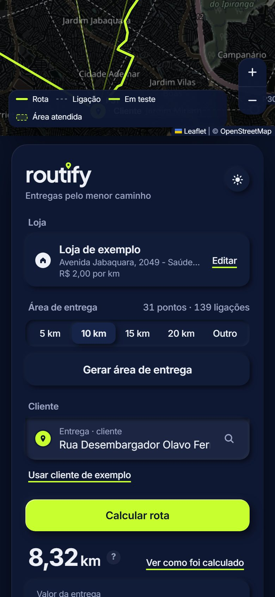
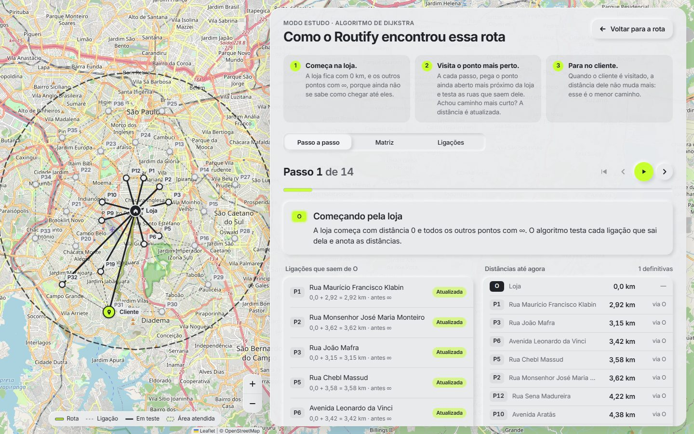

<div align="center">

<picture>
  <source media="(prefers-color-scheme: dark)" srcset="docs/img/logo-escuro.png">
  
</picture>

**Menos voltas, mais entregas.**

O Routify calcula o menor caminho entre uma loja e o cliente usando o algoritmo de Dijkstra e mostra, passo a passo, como chegou nessa resposta.

### [Abrir o Routify](https://routify-frpf.onrender.com)

Funciona no navegador do celular ou do computador, sem instalar nada.

</div>

<br>



## O que dá pra fazer

Você cadastra a loja (nome, endereço, raio de atendimento e quanto cobra por km) e o Routify monta uma área de entrega em volta dela, com pontos em ruas de verdade. Depois é só digitar o endereço do cliente:

- o mapa mostra o caminho escolhido, a distância e o **valor da entrega** (distância × valor por km);
- a rota abre direto no **Google Maps** ou no **Waze**;
- em **Ver como foi calculado** fica o modo estudo, com o Dijkstra rodando passo a passo, a matriz de distâncias e a lista de ligações do grafo.

Os dados da loja ficam salvos só no navegador de quem está usando. Não tem cadastro nem login.

Quer só testar? Use a **loja de exemplo** (Av. Jabaquara, em São Paulo) e o **cliente de exemplo**.

<p align="center">
  
  &nbsp;&nbsp;
  
</p>

## Como funciona

A ideia é a mesma de qualquer app de navegação: as ruas viram um **grafo**, em que cada ponto é um vértice e cada trecho de rua entre dois pontos é uma aresta com a distância em km. A diferença é a escala. O Waze e o Google Maps usam praticamente todos os cruzamentos da cidade, milhões de vértices. O Routify usa uns 30, o suficiente para dar pra acompanhar o algoritmo com os olhos.

1. **Área de entrega.** A partir da loja, o Routify marca pontos em três anéis (a 25%, 50% e 75% do raio) e encaixa cada um na rua mais próxima com o [OSRM](https://project-osrm.org/). Pontos longe demais de uma rua, colados em outro ou com poucas ligações são descartados.
2. **Ligações.** Cada ponto se liga aos vizinhos do mesmo anel e do anel seguinte. O peso de cada ligação é a distância **pelas ruas**, não em linha reta, e pode ser diferente na ida e na volta (mão única existe).
3. **Matriz.** Tudo vira uma matriz de adjacência: na linha *i*, coluna *j*, fica a distância de *i* até *j*. Zero na diagonal e ∞ quando não existe ligação direta.
4. **Cliente.** O endereço do cliente entra no grafo ligado aos pontos que levam até ele pelo caminho mais curto, vindo de direções diferentes.
5. **Dijkstra.** Começa na loja com 0 km e todos os outros pontos com ∞. A cada passo, pega o ponto em aberto mais próximo, testa as ruas que saem dele e atualiza as distâncias que melhorarem. Quando o cliente é fechado, a distância dele é a menor possível.

O Dijkstra foi escrito por nós ([`DijkstraService.java`](src/main/java/br/com/rotas/service/DijkstraService.java)). O OSRM só informa a distância de cada trecho e o desenho da rota no mapa. Quem decide o caminho é o nosso código.

Quando o cliente está perto da loja, muitas vezes o melhor caminho é a ligação direta entre os dois, sem passar por nenhum ponto do meio. Isso não é erro: o Dijkstra comparou as opções e a direta ganhou.



## Tecnologias

| Parte | O que usamos |
|---|---|
| Back-end | Java 21, Spring Boot 3.5, Maven |
| Front-end | HTML, CSS e JavaScript puro, [Leaflet](https://leafletjs.com/) 1.9 para o mapa |
| Mapa e endereços | [OpenStreetMap](https://www.openstreetmap.org/), [Nominatim](https://nominatim.org/) para buscar endereços |
| Distâncias nas ruas | [OSRM](https://project-osrm.org/) (tabela de distâncias e traçado da rota) |
| Testes | JUnit 5 e MockMvc, sem depender dos serviços externos |
| Hospedagem | Docker no [Render](https://render.com/) |

## Limitações

- O grafo é uma **amostra** das ruas, feita para estudo. Não é um mapa completo da cidade.
- As distâncias vêm do servidor público do OSRM, que não considera trânsito.
- O site está no plano gratuito do Render. Se ficar muito tempo sem acesso, a primeira abertura pode levar perto de um minuto.
- Se o OSRM estiver fora do ar, o Routify usa um grafo de reserva com pontos já conferidos da Zona Sul de São Paulo. Sem o Nominatim, a busca de endereços não funciona, mas a loja e o cliente de exemplo continuam funcionando.

## Organização do código

```text
src/main/java/br/com/rotas/
├── controller/    rotas da API (/api/...)
├── domain/        grafo, matriz de adjacência e passos do Dijkstra
├── integration/   Nominatim, OSRM e Overpass
└── service/       geração da área de entrega e o Dijkstra
src/main/resources/
├── static/        o site (HTML, CSS, JS)
└── data/graph.json  grafo de reserva da Zona Sul
```

Mais detalhes em [`docs/`](docs/): o [modelo matemático](docs/MATHEMATICAL_MODEL.md) e a [arquitetura](docs/ARCHITECTURE.md).

## Equipe

Projeto acadêmico feito por:

- **João Victor** · [@joao-vsa](https://github.com/joao-vsa)
- **Eduardo Dias** · [@eduardodiasbentod-prog](https://github.com/eduardodiasbentod-prog)
- **Vitória Silva** · [@vitoriasilvaleite0-commits](https://github.com/vitoriasilvaleite0-commits)
